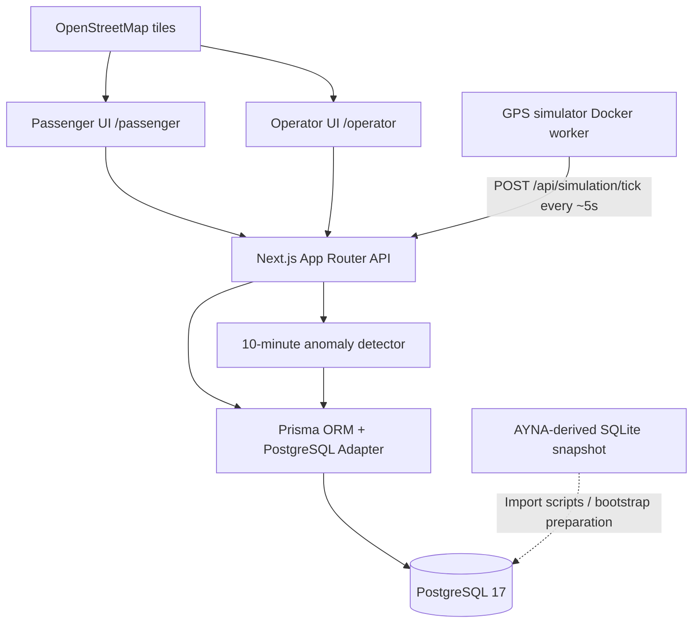
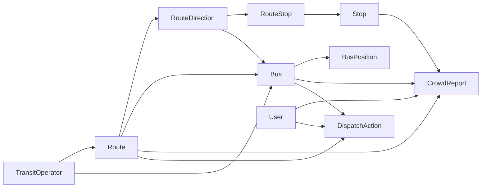

# Smart Transit — Arxitektura qeydləri

## 1. Məqsəd və sərhədlər

Smart Transit sərnişinlərin avtobus marşrutu/dayanacaq seçməsi, simulyasiya GPS üzrə ETA alması, avtobus doluluğu haqqında müşahidə göndərməsi və operatorun bu məlumatları təhlil etməsi üçün hazırlanmış hackathon MVP-sidir.

Sistem real avtobus nəzarət platforması deyil: marşrut-dayanacaq məlumatları üçüncü tərəf **snapshot**, avtomatik avtobus mövqeləri **simulyasiya**, crowd report-lar isə **istifadəçi müşahidələridir**.

## 2. Sistem sxemi



Bu sxemdə `bootstrap preparation` təzə kompüter üçün nəzərdə tutulan mərhələdir; hazırkı GitHub Compose konfiqurasiyasında hələ avtomatik tətbiq olunduğu təsdiqlənməyib.

## 3. Docker servisləri

| Servis | Vəzifə | Qeyd |
|---|---|---|
| `postgres` | PostgreSQL 17, persistent volume | Konteyner: `smarttransit-postgres`, host portu `5433` |
| `web` | Next.js UI və API, Prisma | Konteyner: `smarttransit-web`, host portu `3001` (hazırkı Compose həmçinin `3000` portunu publish edir) |
| `gps-simulator` | 5 saniyəlik POST sorğusu ilə GPS tick | `curlimages/curl` worker; token tələb edir |

Hazırkı Dockerfile web server startından əvvəl `prisma migrate deploy` icra edir. Bu migration-lar **boş demo datasetini avtomatik yaratmır**. Təmiz qurulum üçün ayrıca idempotent bootstrap/seed mərhələsi tələb olunur.

## 4. Domen modeli

| Model | Funksiya |
|---|---|
| `User` | Sərnişin, operator və sistem/demo istifadəçiləri |
| `TransitOperator` | Marşrut və avtobus operatoru |
| `Route` | Marşrut nömrəsi və operator əlaqəsi |
| `RouteDirection` | OUTBOUND/INBOUND, başlanğıc/son və GeoJSON LineString |
| `Stop` | Dayanacaq adı, xarici ID, koordinatlar |
| `RouteStop` | İstiqamət üzrə dayanacaq ardıcıllığı (`sequence`) |
| `Bus` | Fleet ID, tutum, marşrut və istiqamət |
| `BusPosition` | Koordinatlar, sürət, mənbə və timestamp |
| `CrowdReport` | LOW/MEDIUM/HIGH müşahidələri və moderasiya statusu |
| `DispatchAction` | Ehtiyat avtobus barədə qərar/tövsiyə |

Əsas əlaqələr:



## 5. Məlumat axınları

### GPS / ETA

1. `gps-simulator` hər təxminən 5 saniyədə `POST /api/simulation/tick` çağırır.
2. API marşrut istiqamətinin `geometry` koordinatlarından mövqe hesablayır və `BusPosition` yazır (`source=SIMULATION`).
3. `GET /api/live/buses` son mövqeni və təzəlik statusunu qaytarır.
4. `/passenger` və `/operator` xəritələri məlumatı dövri yeniləyir.
5. `GET /api/eta?busId=...&stopId=...` mövcud yanaşmada düz xətt məsafəsi/sürət əsasında ilkin ETA verir.

**Məhdudiyyət:** mövqe trayektoriyası simulyasiyadır; ETA hərəkət istiqaməti, keçilmiş dayanacaq, trafik və real yol müddətini tam əks etdirməyə bilər.

### Crowd Reporting

1. Sərnişin aktiv avtobusu və LOW/MEDIUM/HIGH səviyyəsini seçir.
2. `POST /api/crowd-reports` sorğunun etibarlılığını, avtobus və dayanacaq əlaqəsini yoxlayır.
3. Dəyərlər Prisma enumlarına çevrilir: `LOW → BUS_EMPTY`, `MEDIUM → BUS_MODERATE`, `HIGH → BUS_CROWDED`.
4. Hesabat `CrowdReport`-da `PENDING` statusu ilə saxlanır.
5. Yaradılma uğurlu olduqdan sonra anomaliya detektoru çağırıla bilər.
6. Operator API-si son 30 dəqiqə üçün route üzrə statistikaları hesablayır.

### Anomaliya və dispatch

Detektor hər bir avtobusun son **12 dəqiqəlik** bildiriş pəncərəsinə baxır. Aşağıdakı şərtlər hamısı ödənməlidir:

- Minimum 4 uyğun müşahidə və onların ən azı 3-ü `BUS_CROWDED`
- Minimum 75% HIGH payı
- Minimum 2 fərqli `userId`
- İlk və son müşahidə arasında **ən az 10 dəqiqə**
- Ardıcıl müşahidələr arasında maksimum 5 dəqiqə
- Son müşahidə son 2 dəqiqə ərzində

Şərtlər ödənərsə, uyğun marşrut üçün aktiv `PROPOSED` və ya `APPROVED` tövsiyəsi yoxlanaraq təkrarsız `DispatchAction` yaradılması nəzərdə tutulur. `PROPOSED` fiziki avtobus göndərmək deyil — insan təsdiqi tələb edən tövsiyədir.

**Əhəmiyyətli məhdudiyyət:** Mövcud lokal demo report endpoint-i tək demo istifadəçisi ilə işləyir; onun təkrar bildirişləri 2 müstəqil istifadəçi şərtini ödəyə bilməz. `PENDING` müşahidələr müxtəlif şəxslərdən gəlmiş kimi təsdiqlənməməlidir. Real `DispatchAction` yaratma yolunun inteqrasiya testi hələ ayrıca təsdiqlənməlidir.

### Sintetik test

`GET /api/operator/anomalies?demo=true` simulyasiya olunmuş məlumatları yalnız yaddaşda detektora verir və iki vəziyyəti nümayiş etdirir:

- 11 dəqiqəlik kifayət qədər davamlı HIGH: `detected=true`
- Tək HIGH bildirişi: `detected=false`

Bu rejim **heç bir saxta tarixi crowd report və dispatch əməliyyatı yazmır**. Hakimlər qarşısında `SYNTHETIC_DEMO` kimi açıq göstərilməlidir.

## 6. Data provenance

- Mənbə: `data/ayna.sqlite` (mövcud olduqda); üçüncü tərəf nəqliyyat məlumatı snapshot-ı.
- PostgreSQL-ə idxal edilmiş müşahidə: 3 456 real mənbə adı və koordinatı, iki mənbə marşrutu üçün 103 `RouteStop` əlaqəsi (1: 21/24; 12: 28/30).
- Snapshot məlum olduğu üçün onun **hazırkı rəsmi vəziyyətlə eyni** olduğunu fərz etməyin.
- Köhnə test marşrutları (`BBU → BDU` və s.) idxal edilmiş həqiqi xətt nömrələri ilə birləşdirilməməlidir.

## 7. API və məsuliyyətlər

| Endpoint | Təyinat |
|---|---|
| `GET /api/passenger/routes` | Marşrut, istiqamət və dayanacaqlar |
| `GET /api/live/buses` | Avtobusların son GPS mövqeləri |
| `GET /api/eta` | Dayanacaq üçün ilkin ETA |
| `POST /api/simulation/tick` | Qorunan simulyasiya tick-i |
| `POST /api/crowd-reports` | Sıxlıq bildirişi |
| `GET /api/operator/analytics` | Marşrut üzrə 30 dəqiqəlik göstəricilər |
| `GET /api/operator/anomalies` | Dispatch tövsiyələri |
| `GET /api/operator/anomalies?demo=true` | DB-yə yazılmayan sintetik detektor testi |

## 8. Təhlükəsizlik qərarları

- Admin token `x-admin-token` başlığı ilə yalnız qorunan endpoint-lərdə yoxlanmalıdır.
- Lokal demo flag-lər (`ENABLE_LOCAL_ADMIN_API`, `ENABLE_DEMO_CROWD_REPORTS`) açıq internetdə aktiv saxlanmamalıdır.
- Real istifadəçi autentifikasiyası, rate limiting, rol əsaslı icazələr və audit logging istehsalat üçün ayrıca tələb olunur.
- PostgreSQL və tətbiq portları yalnız lazım olan interfeyslərə bağlanmalıdır.
- `.env` və credential-lər Git-ə daxil edilməməlidir.
- Crowd report-lar yoxlanmadan real sərnişin sayı və ya faktiki sıxlıq kimi təqdim edilməməlidir.

## 9. Etibarlılıq və yoxlama

Tövsiyə olunan minimum yoxlamalar:

```bash
docker compose ps
docker compose logs --tail=20 web
docker compose logs --tail=20 gps-simulator
```

- PostgreSQL `healthy` olmalıdır.
- GPS worker-də uğurlu tick-lər görünməlidir.
- `/api/live/buses` fərqli vaxtlarda yeni `recordedAt` qaytarmalıdır.
- `/api/passenger/routes` real dayanacaq ardıcıllığını göstərməlidir.
- `/api/operator/analytics` son bildirişlərin cəmini düzgün hesablamalıdır.
- Sintetik anomaliya testində həm müsbət, həm mənfi ssenari doğru olmalıdır.
- Təmiz volume üzərində ilkin idxal və avtomatik demo seed təsdiqlənməlidir.

## 10. Sonrakı texniki təkmilləşdirmələr

1. Docker daxilində idempotent **bootstrap** servisi, avtomatik snapshot idxalı və demo avtobus seed-i.
2. Təmiz kompüterdə bir əmrlə başlama üçün end-to-end smoke test.
3. Daha dəqiq marşrut üzrə ETA (keçilmiş dayanacaq və xətt boyunca məsafə).
4. Müxtəlif simulyasiya avtobuslarının fərqli başlanğıc mövqeləri.
5. Həqiqi istifadəçi identifikasiyası və crowd report etibarlılıq yoxlaması.
6. DispatchAction üçün tam inteqrasiya və concurrency testləri.

---

**Status:** Hackathon MVP; istehsalat səviyyəsində real vaxtlı nəqliyyat sistemi deyil.
